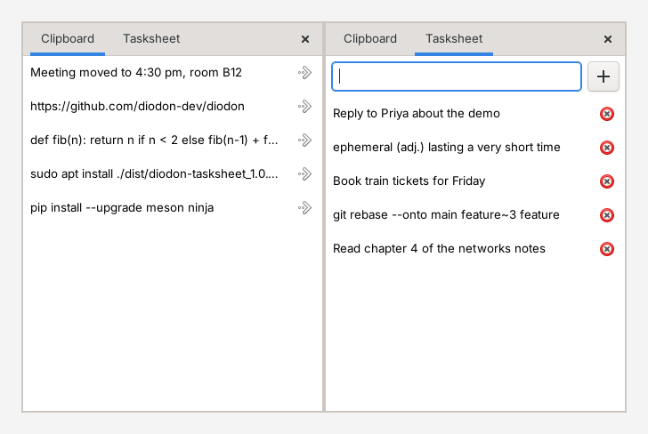

  # Diodon Tasksheet

  [](https://github.com/blackirron/diodon-tasksheet/releases/latest)
  [](COPYING)

  A plugin for the [Diodon](https://github.com/diodon-dev/diodon) clipboard manager
  that adds a **Tasksheet** next to your clipboard history: a personal list of
  words and notes that you can keep, copy back with one click, and fill by moving
  items over from the clipboard.

  

  This is an independent project by Samir Pravin Nimgade. It is not part of
  Diodon and is not endorsed by the Diodon authors. Nothing in Diodon is patched
  or replaced.

  ## Features

  * A second tab with your own list, kept separate from the clipboard history
  * Add a task by typing it and pressing Enter
  * Move a clipboard item to the tasksheet with one click or by drag and drop
  * Click a task to copy its text to the clipboard (the task stays in the list)
  * Updates instantly, no need to close and reopen the popup
  * Optional keyboard shortcuts on GNOME: Win+V for the clipboard, Win+Y for the tasksheet
  * Tasks survive restarts and are stored in one small text file

  ## Install

  Tested on Ubuntu 24.04 with Diodon 1.13. If you are on a different release or
  distribution, use option 2 or 3.

  You need Diodon itself first:

  ```bash
  sudo apt install diodon zeitgeist-core
  ```

  ### Option 1: download the package (Ubuntu and Debian)

  1. Open the [latest release](https://github.com/blackirron/diodon-tasksheet/releases/latest)
    and download `diodon-tasksheet_1.0.1_amd64.deb`.
  2. Install it from the folder where it was saved:

    ```bash
    sudo apt install ./diodon-tasksheet_1.0.1_amd64.deb
    ```

  The package turns the plugin on and restarts Diodon if it is running. Open
  Diodon from the tray and you will see the **Tasksheet** tab. Apt may print a
  note that the download ran "unsandboxed as root"; it is harmless.

  ### Option 2: build the package yourself (Debian and Ubuntu, any release)

  A Diodon plugin links against the Diodon on your machine, so building it
  locally gives the best match for other releases.

  ```bash
  git clone https://github.com/blackirron/diodon-tasksheet.git
  cd diodon-tasksheet
  bash scripts/build-deb.sh
  sudo apt install ./dist/diodon-tasksheet_*.deb
  ```

  `build-deb.sh` installs the build packages (it asks for `sudo` once), reads
  where your Diodon keeps its plugins, builds, runs the unit tests and checks the
  result. On Ubuntu the development package lives in the `universe` repository;
  if apt cannot find `diodon-dev`, run
  `sudo add-apt-repository universe && sudo apt update` and try again.

  ### Option 3: install for your user only (any distribution, no root)

  You need Diodon with its development files (`pkg-config diodon` must print a
  version), GTK 3, libpeas 1.x, valac, meson and ninja. On Debian and Ubuntu:

  ```bash
  sudo apt install diodon diodon-dev libgtk-3-dev libpeas-dev valac meson ninja-build zeitgeist-core
  ```

  Then:

  ```bash
  git clone https://github.com/blackirron/diodon-tasksheet.git
  cd diodon-tasksheet
  bash scripts/install.sh
  pkill -x diodon; diodon &
  ```

  This builds the plugin, runs the unit tests and installs it under
  `~/.local`. To use a Diodon you built yourself, add
  `--diodon-prefix /path/to/its/prefix`.

  ## Using it

  * **Clipboard tab:** Diodon's text history. Click a row to paste it.
  * **Tasksheet tab:** type a word or note and press Enter, or click **+**. The
    bin button deletes a task. Clicking a task copies its text.
  * **Move from the clipboard:** click the arrow on a clipboard row, or drag the
    row onto the Tasksheet tab.
  * **Menu:** Diodon's menu also has a **Tasksheet...** entry.

  ### Keyboard shortcuts (optional)

  ```bash
  diodon-tasksheet hotkeys           # GNOME: Win+V and Win+Y
  diodon-tasksheet hotkeys --undo    # put everything back
  ```

  Pressing a shortcut again closes the popup. GNOME already uses Win+V for its
  notification list, so shortcuts are not set up automatically. The script
  releases that binding, registers the new ones, checks them, and remembers what
  it changed so that `--undo` restores it exactly. On other desktops, create two
  custom shortcuts that run `diodon-tasksheet clipboard` and
  `diodon-tasksheet tasksheet`. Diodon must be running.

  ### The `diodon-tasksheet` command

  | Command | What it does |
  |---------|--------------|
  | `tasksheet` (default) or `clipboard` | Open or close that tab |
  | `enable` or `disable` | Turn the plugin on or off in your Diodon settings |
  | `hotkeys [--undo]` | Set up or remove the GNOME shortcuts |

  See also `man diodon-tasksheet`.

  ## Uninstall

  Installed from the package:

  ```bash
  sudo apt remove diodon-tasksheet
  ```

  Installed with `install.sh`:

  ```bash
  bash scripts/uninstall.sh            # keeps your tasks
  bash scripts/uninstall.sh --purge    # also deletes them
  ```

  Your tasks live in `~/.local/share/diodon/tasksheet.ini`. Removing the plugin
  does not delete that file, so reinstalling brings your list back.

  ## Troubleshooting

  **`Unable to locate package diodon-dev`**
  The package is in Ubuntu's `universe` repository. Run
  `sudo add-apt-repository universe && sudo apt update` and try again.

  **`Unsupported file ... .deb given on commandline`**
  There is no package to install because the build did not finish. Scroll up to
  the first error from `build-deb.sh`, fix it, and check with `ls dist/`.

  **The Tasksheet tab does not appear after installing**
  Restart Diodon with `pkill -x diodon; diodon &`. If it still does not show,
  check that the plugin is active:

  ```bash
  gsettings get net.launchpad.Diodon.plugins active-plugins   # should include 'tasksheet'
  diodon-tasksheet enable
  ```

  **The clipboard history fills with half-selected fragments**
  Entries such as `p`, `pt` and `pt ins` come from Diodon's own primary selection
  option, which saves text as you drag to highlight it. The plugin does not
  change Diodon's clipboard settings. Put them back to the defaults:

  ```bash
  gsettings reset-recursively net.launchpad.Diodon.clipboard
  pkill -x diodon; diodon &
  ```

  You can also untick "Use primary selection" and "Synchronize clipboards" in
  Diodon's Preferences. Use Clear in Diodon's menu to remove entries already saved.

  ## Limits

  * Same platform as Diodon: GTK 3, libpeas and Zeitgeist. Without the
    `zeitgeist-core` service the Clipboard tab says why it is empty.
  * On Wayland, Diodon is an X11 program and may not see text copied in
    Wayland-native applications, so the Clipboard tab can stay empty. That is a
    Diodon limitation, not this plugin's. The Tasksheet tab, the shortcuts and the
    menu entry work either way. Wayland also ignores window positions requested
    by applications, so the popup opens where the compositor puts it.
  * Only text items are listed in the Clipboard tab.

  ## How it works

  The plugin is built against an installed Diodon and uses only Diodon's public
  plugin API:

  | Need | What is used |
  |------|--------------|
  | Lifecycle, listed under Preferences, Plugins | `Peas.Activatable` |
  | A menu entry that survives every menu rebuild | `Controller.add_static_recent_menu_item()` |
  | Read, paste and remove history | `Controller.get_recent_items()`, `select_item_by_checksum()`, `remove_item()` |
  | Keyboard shortcuts | A small D-Bus service, `org.diodon.Tasksheet` |

  Diodon dropped its built-in global hotkeys in version 1.4.0, and applications
  cannot grab global keys on Wayland at all. So the desktop owns the shortcut and
  runs `diodon-tasksheet clipboard` or `diodon-tasksheet tasksheet`, which works
  on both Wayland and X11. A separate popup window is used instead of tabs in the
  tray menu because that menu is exported to the shell over D-Bus and can only
  hold plain menu items.

  The Debian package turns the plugin on through a GSettings default generated
  from Diodon's own schema. Installing or removing it restarts a running Diodon so
  the tab appears or disappears at once.

  ## Development

  ```bash
  git clone https://github.com/blackirron/diodon-tasksheet.git
  cd diodon-tasksheet
  meson setup build -Dplugin_dir=$PWD/build/plugin -Dbin_dir=$PWD/build/bin
  meson compile -C build
  meson test -C build --print-errorlogs     # storage and label tests, no display needed
  ```

  To try a change without touching your system Diodon, run `bash test-install.sh`.
  It builds an unmodified Diodon into `~/diodon-tasksheet-test`, installs the
  plugin into it and starts it. Delete that folder to undo.

  Layout: `src/` holds the plugin (`tasksheet-storage.vala` is plain GLib and unit
  tested, `tasksheet-popup.vala` is the GTK window, `tasksheet-plugin.vala` is the
  entry point that registers the menu entry and the shortcut service), `tests/`,
  `scripts/`, `bin/diodon-tasksheet.in`, `data/` (plugin descriptor and man page)
  and `debian/`.

  ## Contributing

  Bug reports and pull requests are welcome. For a bug, please include your
  distribution and release, your Diodon version (`apt policy diodon`), whether you
  use Wayland or Xorg (`echo $XDG_SESSION_TYPE`), and any messages Diodon prints
  when started from a terminal. See [CHANGELOG.md](CHANGELOG.md) for what changed
  between versions.

  ## License

  GPL-2.0-or-later, the same as Diodon. The full text is in [COPYING](COPYING).
